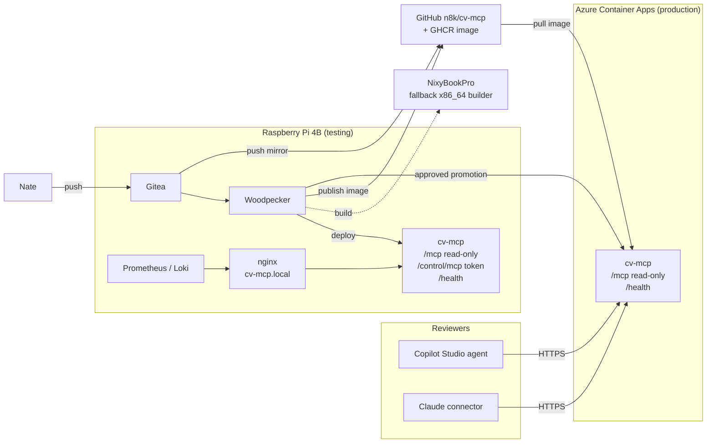

# cv-mcp — Architecture

Status: Draft

## Overview

One Python process (FastMCP over Streamable HTTP) reads `cv.toml` on every
call and answers MCP requests. The same image runs in two places: a testing
tier on the Pi behind nginx, with an extra control endpoint, and a read-only
production tier on Azure Container Apps that reviewers reach over public HTTPS.

## Components

### cv-mcp

- Responsibility: load and validate `cv.toml`; strip `TODO` placeholders;
  expose the CV as MCP tools, resources and a prompt; in testing only, expose
  control tools.
- Language and tier: Python, Tier 2. Reason: needs FastMCP.
- Key libraries:
  - `fastmcp` 4.x (pinned to 4.1.3, the tested version). In nixpkgs:
    unverified; package it in the flake if missing or too old.
  - `tomllib` from the Python standard library (no extra dependency).
  - `pytest` for tests (in nixpkgs).
- Interfaces exposed: see Interfaces.
- Interfaces consumed: none at runtime.

Code changes from the current repo:

- Remove the YAML and JSON loaders, `cv.yaml`, `cv.json` and the `pyyaml`
  dependency.
- Whole-word, case-insensitive matching in `search_cv` and `assess_role_fit`
  (`\b<keyword>\b` with `re.escape`; multi-word keywords match as phrases).
- Control endpoint built as a separate FastMCP instance, mounted only when
  `CV_MCP_CONTROL_TOKEN` is set.
- Delete the Dockerfile and `requirements.txt` once the flake replaces them.

## Data

- One file, `cv.toml`, in the repo. It holds `person`, `experience`, `skills`,
  `case_studies` and `target_role`.
- Size is a few kilobytes; no database and no runtime writes.
- Testing tier: the file is baked into the image. `reload` re-reads it after a
  redeploy; nothing persists under `/opt/cicd/cv-mcp/testing/` beyond what the
  pipeline places there.
- Production: the file is baked into the image; no volume.
- Backups: the Git repo is the backup.
- `examples/cv.example.toml` is test data only, never served in production.

## Interfaces

| Endpoint | Tier | Purpose |
|---|---|---|
| `POST/GET /mcp` | testing, production | Read-only MCP (Streamable HTTP) |
| `/control/mcp` | testing only | Control MCP; requires `Authorization: Bearer <CV_MCP_CONTROL_TOKEN>` |
| `GET /health` | testing, production | Returns `{"status":"ok"}` once the CV file parses |
| `GET /` | testing, production | Short plain-text pointer to `/mcp` |

Read-only MCP surface:

- Tools: `get_profile`, `get_experience(company?)`, `get_skills(category?)`,
  `list_case_studies`, `get_case_study(case_id)`, `search_cv(query)`,
  `assess_role_fit(role_title?)`. All annotated `readOnlyHint`.
- Resources: `cv://full` (JSON), `cv://markdown`.
- Prompt: `interview_candidate(focus?)`.

Control MCP surface (testing):

- `validate_cv`: parses the file and lists remaining `TODO`s, missing fields
  and criteria with no evidence.
- `reload`: clears any cached state and re-reads the file.

External APIs: none at runtime. CI uses the GHCR registry API and the Azure
Container Apps management API.

## Deployment

- Built by: project flake.
  - `devShells.default` and `devShells.ci`: Python with FastMCP, pytest.
  - `packages.cv-mcp`: the app.
  - `packages.image`: `dockerTools.streamLayeredImage` for `x86_64-linux`.
- Build host: the Pi, substituting x86_64 packages from the binary cache.
  If anything needs compiling for x86_64, the build runs on NixyBookPro
  as a remote builder.
- Testing tier (Pi):
  - Runs as an oci-container, with the same image as production. The Pi is
    aarch64, so it needs either an aarch64 build of the same flake output or
    x86_64 emulation. Plan: build both architectures from the flake, test the
    aarch64 one on the Pi, and ship the x86_64 one. Tests also run against the
    x86_64 image where a builder allows.
  - Port: next free port in the project block assigned by `pipeline-factory`,
    bound to `127.0.0.1`.
  - Hostname: `cv-mcp.local` via host nginx with the shared certificate.
- Production (Azure Container Apps, Consumption plan, personal subscription):
  - Image: public `ghcr.io/n8k/cv-mcp:<git-sha>`.
  - Ingress: external, HTTPS, target port 8000.
  - Scale: min 0, max 1 replica; 0.25 vCPU and 0.5 GiB.
  - URL: Azure-assigned `*.azurecontainerapps.io` for v1.
  - Promotion: Woodpecker pipeline step gated on manual approval, using the
    Azure CLI with a service principal scoped to the app's resource group.
- Resource expectations: about 60–100 MB RAM per process (estimate, measure
  in M4); negligible CPU and disk.

## Secrets

| Name | Scope | Used by |
|---|---|---|
| `CV_MCP_CONTROL_TOKEN` | runtime (testing), sops-nix | Control endpoint on the Pi |
| `GHCR_TOKEN` | CI, Woodpecker | Publishing the image |
| `AZURE_CLIENT_ID` | CI, Woodpecker | Production deploy |
| `AZURE_TENANT_ID` | CI, Woodpecker | Production deploy |
| `AZURE_CLIENT_SECRET` | CI, Woodpecker | Production deploy |
| `AZURE_SUBSCRIPTION_ID` | CI, Woodpecker | Production deploy |

Production has no runtime secrets.

## Observability

- Testing: Prometheus probes `https://cv-mcp.local/health` at the default
  interval; logs go through journald to Loki.
- Production: probe `/health` no more than every 30 minutes. Each probe can
  wake a scaled-to-zero replica, and frequent probes would keep it running and
  spend the free grant. Azure's own log stream is enough for v1.
- Alert worth having: production `/health` failing twice in a row.

## Security

- Trust boundary: the public internet reaches only the production read-only
  endpoint. Anyone can call it.
- What an attacker can do on production: read the CV, which is public anyway,
  and spend free-grant requests. Max one replica caps the cost of abuse;
  exceeding the grant would be billed, so set an Azure budget alert.
- Testing control endpoint: reachable only on the home network through nginx,
  and only with the token. Its tools change nothing persistent.
- Content safety: `cv.toml` is public by design; only LinkedIn-level content
  belongs in it.
- Supply chain: dependency versions pinned by the flake lock.

## Alternatives considered

- **Go or Rust instead of Python.** Both have maintained official MCP SDKs.
  Not chosen: FastMCP was wanted and the Python server was already working.
- **Google Cloud Run.** Same free allowance as Azure. Not chosen: Azure fits
  the Copilot Studio story; pulling from GHCR is less certain on Cloud Run.
- **Render free tier.** Not chosen: about one minute to wake after 15 minutes
  idle.
- **Fly.io.** Not chosen: no free plan for new customers.
- **Production on the Pi through Cloudflare Tunnel.** Not chosen: Nate prefers
  cloud hosting, which keeps the home network out of the public path.
- **Dockerfile.** Not chosen: images are Nix-built by platform rule.
