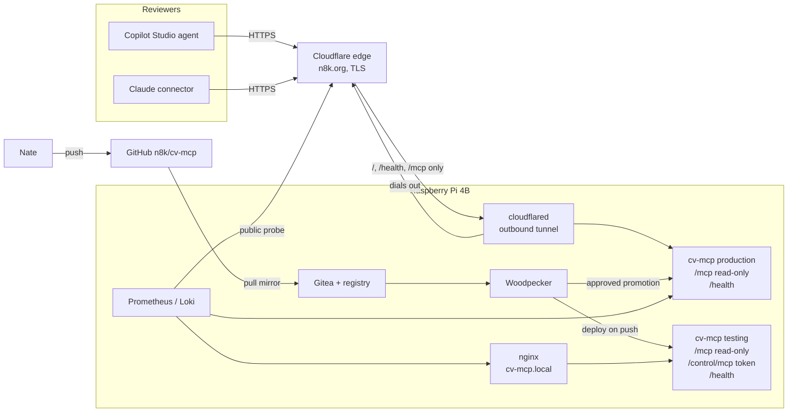

# cv-mcp — Architecture

Status: Approved 2026-10-22. Revised 2026-10-23: production moved from Azure
Container Apps to the Pi behind a Cloudflare Tunnel (approved by merging the PR
that carries this revision).

## Overview

One Python process (FastMCP over Streamable HTTP) reads `cv.toml` on every
call and answers MCP requests. The same aarch64 image runs as two tiers on the
Pi: testing, on the home network behind nginx with an extra control endpoint,
and a read-only production tier that reviewers reach at `https://n8k.org`
through a Cloudflare Tunnel.

## Components

### cv-mcp

- Responsibility: load and validate `cv.toml`; strip `TODO` placeholders;
  expose the CV as MCP tools, resources and a prompt; in testing only, expose
  control tools.
- Language and tier: Python, Tier 2. Reason: needs FastMCP.
- Key libraries:
  - `fastmcp` 4.x (pinned to 4.1.3, the tested version). In nixpkgs:
    unverified; package it in the flake if missing or too old.
  - `tomllib` from the Python standard library (no extra dependency).
  - `pytest` for tests (in nixpkgs).
- Interfaces exposed: see Interfaces.
- Interfaces consumed: none at runtime.

Code changes from the current repo:

- Remove the YAML and JSON loaders, `cv.yaml`, `cv.json` and the `pyyaml`
  dependency.
- Whole-word, case-insensitive matching in `search_cv` and `assess_role_fit`
  (`\b<keyword>\b` with `re.escape`; multi-word keywords match as phrases).
- Control endpoint built as a separate FastMCP instance, mounted only when
  `CV_MCP_CONTROL_TOKEN` is set.
- Delete the Dockerfile and `requirements.txt` once the flake replaces them.

## Data

- One file, `cv.toml`, in the repo. It holds `person`, `experience`, `skills`,
  `case_studies` and `target_role`.
- Size is a few kilobytes; no database and no runtime writes.
- Testing tier: the file is baked into the image. `reload` re-reads it after a
  redeploy; nothing persists under `/opt/cicd/cv-mcp/testing/` beyond what the
  pipeline places there.
- Production: the file is baked into the image; no volume.
- Visit log: written to stdout only (see Observability). The container stores
  nothing.
- Backups: the Git repo is the backup.
- `examples/cv.example.toml` is test data only, never served in production.

## Interfaces

| Endpoint | Tier | Purpose |
|---|---|---|
| `POST/GET /mcp` | testing, production | Read-only MCP (Streamable HTTP) |
| `/control/mcp` | testing only | Control MCP; requires `Authorization: Bearer <CV_MCP_CONTROL_TOKEN>` |
| `GET /health` | testing, production | Returns `{"status":"ok"}` once the CV file parses |
| `GET /` | testing, production | Landing page for browsers (`src/cv_mcp/index.html`: the server URL and how to connect from Claude and Copilot Studio, with sample prompts); a one-line plain-text pointer to `/mcp` for other clients |

Read-only MCP surface:

- Tools: `get_profile`, `get_experience(company?)`, `get_skills(category?)`,
  `list_case_studies`, `get_case_study(case_id)`, `search_cv(query)`,
  `assess_role_fit(criteria?, role_title?)`. All annotated `readOnlyHint`.
  `criteria` is up to 20 items of `{name, keywords[1–30]}`, validated by schema;
  without it the generic defaults from `cv.toml` are used and the result says so.
- Resources: `cv://full` (JSON), `cv://markdown`.
- Prompt: `interview_candidate(job_description?, focus?)`.

Control MCP surface (testing):

- `validate_cv`: parses the file and lists remaining `TODO`s, missing fields
  and criteria with no evidence.
- `reload`: clears any cached state and re-reads the file.

External APIs: none at runtime. CI uses only the Gitea container registry on
the Pi.

## Deployment

- Built by: project flake.
  - `devShells.default` and `devShells.ci`: Python with FastMCP, pytest.
  - `packages.cv-mcp`: the app.
  - `packages.image`: `dockerTools.streamLayeredImage`, built natively on the
    Pi (aarch64). The flake also builds for x86_64-linux, for development on
    the laptop.
- Registry: Gitea on the Pi, `gitea.local/nate/cv-mcp:<git-sha>`. CI publishes
  each scanned `main` commit there.
- Both tiers run as docker compose projects on the Pi, from the same image, each
  bound to `127.0.0.1` on a port from the project's block (8250–8259):
  - Testing: port 8250, `https://cv-mcp.local` through host nginx with the
    shared certificate; deployed on every push to `main`.
  - Production: port 8251; deployed only when Nate promotes a tested pipeline
    in Woodpecker. Production runs the exact image testing ran; nothing is
    rebuilt.
- Public access (production): `cloudflared` on the Pi keeps an outbound tunnel
  to Cloudflare. Cloudflare serves `https://n8k.org` (DNS, TLS) and forwards
  requests through the tunnel. The tunnel forwards only `/`, `/health` and
  `/mcp` for `n8k.org`; every other path or hostname gets a 404 from
  `cloudflared`. No inbound port is opened on the router or the Pi.
- Defined in the NixOS config repo: `hosts/nixos/projects/cv-mcp-pipeline.nix`
  (tiers, deploy units, tunnel, probes, secrets).
- Resource expectations: about 60–100 MB RAM per tier; negligible CPU and disk.

## Secrets

| Name | Scope | Used by |
|---|---|---|
| `CV_MCP_CONTROL_TOKEN` | runtime (testing), sops-nix | Control endpoint on the Pi |
| Cloudflare Tunnel credentials (`cloudflared/cv-mcp`) | runtime (host), sops-nix | `cloudflared` |
| `ci_registry_user`, `ci_registry_password` | CI, Woodpecker (global, existing) | Publishing and tagging the image |

Production has no runtime secrets. The Cloudflare account certificate
(`cert.pem`) is not needed to run the tunnel and is not kept on the Pi.

## Observability

- Testing: Prometheus probes `http://127.0.0.1:8250/health` at the default
  interval; logs go through journald to Loki (tag `cv-mcp-testing`).
- Production: probed twice, locally (`http://127.0.0.1:8251/health`) and
  publicly (`https://n8k.org/health`, through Cloudflare and the tunnel), so a
  tunnel or DNS failure alerts as well as a container failure. There is no
  scale-to-zero, so frequent probes cost nothing. Logs go to Loki (tag
  `cv-mcp-production`).
- Alert: `ProjectProbeFailed` fires after 3 minutes of failed probes, which
  covers "production `/health` failing twice in a row".
- Visit log: `VisitLog`, an ASGI middleware in front of the app, writes one JSON
  line per request (`"event": "visit"`) to stdout:

  | Field | Content |
  |---|---|
  | `ts`, `kind`, `method`, `path`, `status`, `ms` | When, what (`page`, `root`, `mcp`, `other`), result, duration |
  | `country`, `ip` | Cloudflare's `CF-IPCountry`; `CF-Connecting-IP` (else `X-Real-IP`, else the peer) cut to its /24 or /48 network |
  | `ua`, `referrer` | Browser (300 characters); referrer without query or fragment |
  | `session` | `Mcp-Session-Id`, which ties a session's calls together |
  | `rpc[]` | Per JSON-RPC message: `method`; `client` (name, version) on `initialize`; `tool` and `args` on `tools/call`; `uri` or `prompt`; and `result` or `error` from the reply |

  Arguments and results are capped at 4,000 characters each. `/health` (probe
  noise) and `/control` are not logged; no other request header is read into
  the log. journald (tag `cv-mcp-<tier>`) carries it to Loki through Alloy;
  both keep 30 days. The Grafana dashboard "CV visitors" in the NixOS repo
  reads it with LogQL.

## Security

- Trust boundary: the public internet reaches only Cloudflare. Cloudflare
  reaches only the production container, and only `/`, `/health` and `/mcp`,
  through the tunnel `cloudflared` opened from the Pi. Anyone can call those.
- What an attacker can do on production: read the CV, which is public anyway,
  and send load to the Pi. The container is read-only and runs as a non-root
  user; production serves no control endpoint (enforced by an assertion in the
  NixOS module, and unreachable anyway because the tunnel does not forward
  `/control`). Cloudflare's free plan adds DDoS protection; a rate-limiting
  rule can be added in its dashboard if abuse appears.
- What changes compared with a cloud host: the home network is now behind the
  public path. Exposure is limited to one outbound connection and one
  localhost port; a compromise of the container would still be on the Pi, so
  it stays read-only, unprivileged and without secrets.
- Testing control endpoint: reachable only on the home network through nginx,
  and only with the token. Its tools change nothing persistent.
- Content safety: `cv.toml` is public by design; only LinkedIn-level content
  belongs in it.
- Supply chain: dependency versions pinned by the flake lock.
- Visit log: holds personal data (network-level IPs, job descriptions passed
  to `assess_role_fit`). It stays on the Pi (journal and Loki, LAN-only Grafana),
  expires after 30 days, and is announced on the landing page and in the MCP
  instructions. A logging failure never fails a request.

## Alternatives considered

- **Go or Rust instead of Python.** Both have maintained official MCP SDKs.
  Not chosen: FastMCP was wanted and the Python server was already working.
- **Azure Container Apps.** Chosen first (free grant, scale-to-zero, same
  ecosystem as Copilot Studio), dropped on 2026-10-23: the setup was too heavy
  for a small public service, and it needed an x86_64 image built under
  emulation and a second registry.
- **Google Cloud Run.** Same free allowance as Azure. Not chosen: needs a
  billing account and Artifact Registry, about as much setup as Azure.
- **Koyeb.** Free instance pulls from GHCR directly. Not chosen: 0.1 vCPU makes
  Python cold starts slow.
- **Oracle Cloud Always Free.** Arm VM, so the same image would run. Not
  chosen: a second host to run and secure, and a hard sign-up.
- **Render free tier.** Not chosen: about one minute to wake after 15 minutes
  idle.
- **Fly.io.** Not chosen: no free plan for new customers.
- **Production on the Pi through Cloudflare Tunnel.** First not chosen, to keep
  the home network out of the public path; chosen on 2026-10-23 with the
  mitigations under Security.
- **Dockerfile.** Not chosen: images are Nix-built by platform rule.
